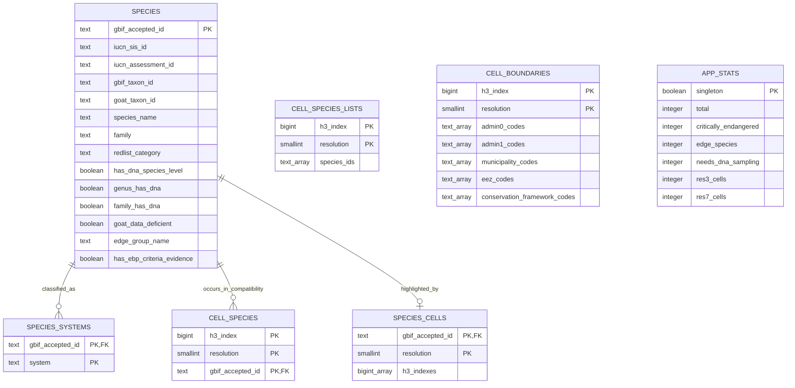

# Serving schema

The global application uses PostgreSQL for relational API reads and keeps the
large resolution-7 aggregate and species-list partitions outside the database.
This diagram replaces the prototype-era database screenshots.

`cell_species` is retained only for compatibility and small builds. Global
serving uses one `cell_species_lists` row per coarse H3 cell and one
`species_cells` inverse row per species. Fine resolution-7 map metrics and exact
selected-cell species lists are read from independently versioned, spatially
partitioned Parquet files.

`cell_boundaries` records every boundary intersected by a cell. Multiple values
are arrays, so a border cell can belong to more than one jurisdiction. Country
memberships already include their matching EEZ scope; `eez_codes` remains for
location context and internal queries, not as a separate user-facing filter.

The authoritative DDL is `backend/schema.sql`. Build-time DuckDB relations are
transient transformation details and are intentionally absent from this serving
diagram.

## Optional analytical details

Assessment trend/date/scope/threat text and its input checksum are nullable
species columns. Their serving export and PostgreSQL loader use explicit
projections; they are not map metric properties. The assessment endpoint matches
the selected species record's SIS and assessment identifiers.

`species_phylogenetic_scores` is an optional table keyed by SIS ID, retaining
generation, ED/EDGE components, marginal gap, evidence flags, availability and
nearest-relative diagnostics. It does not replace categorical species scores.
Dynamic rule/weight scenarios are served from checked private Parquet generations.

Range/stewardship, retained polygon/point/basin support and tree-independent DNA
generations are separate optional Parquet products. Their paginated/selected
detail endpoints return 503 when the configured product is unavailable. See
[the implementation guide](../pipeline/11_scoring_implementation.md) for schemas,
environment paths and scientific interpretation. The 164-column base metric
schema, coarse Arrow and fine metric arrays are unchanged.
